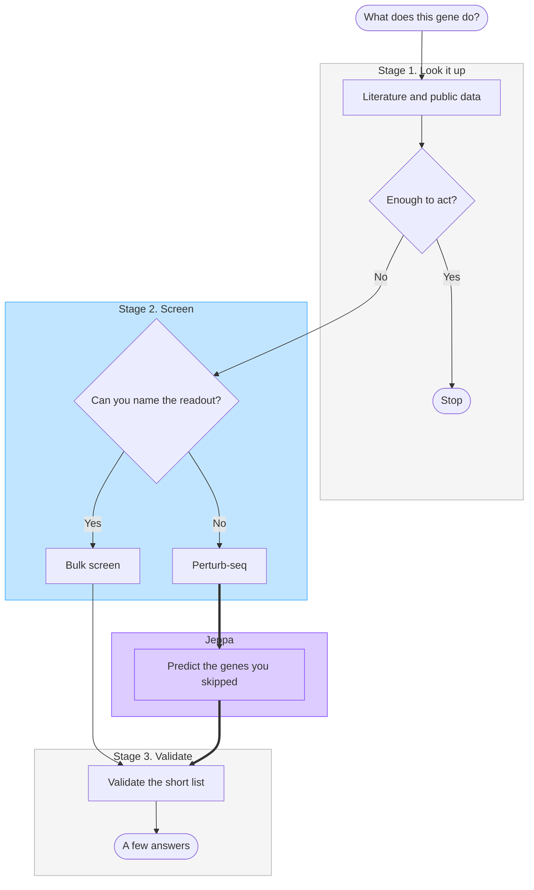

# Figma brief: wet-lab process poster

Give this document to Figma as the full instruction set. Build a FigJam board a hackathon judge can read in under a minute. The board explains what a wet-lab researcher does, shows that path as one flowchart, and marks the single step Jeppa changes.

Do not add a model diagram. Do not explain architecture, training, losses, or benchmarks.

## What the board has to make someone say

1. Today, a lab that wants to know what a gene does looks up what is already known, runs a screen, then validates a short list.
2. The expensive, cell-hungry step is Perturb-seq: a full readout of what changed when that gene is suppressed.
3. Jeppa does not remove that screen and does not make it faster. It predicts the genes the lab could not screen, so the same validation step starts from a larger short list. A fixed cell budget covers about 10x more genes.

## Format

- One landscape FigJam board. No second diagram.
- Three zones, left to right: a short stage strip, the flowchart, an impact panel.
- Type, boxes, and arrows only. No photos, no icons of pipettes, cells, DNA, or brains, no decorative illustration.
- Readable as a poster. Short labels inside shapes. Longer sentences live in the stage strip and the impact panel, not inside diamonds.
- Print the product name as **Jeppa**. Do not write JEPA, scGPT, or Cell-JEPA anywhere on the board.

## Zone 1. Current process (left)

Title:

> What a lab does when it does not know what a gene does

Three stacked lines. These are the current process in words. They are not a second flowchart.

1. **Look it up.** Free. Days. Literature and public data. For most genes, there is little to read, and what exists is only a correlation.
2. **Run a screen.** Months. This is the first causal evidence, in your own cells. You have to pick a readout before you start.
3. **Validate a short list.** More weeks, one gene per well. This step happens either way.

Under the three lines, one sentence:

> Each stage looks at fewer genes and trusts the answer more.

## Zone 2. Flowchart (center)

One top-to-bottom flowchart. This is the only diagram.

Story the arrows must tell:

- Start from the question, not from a database or a model.
- Looking it up can end the process when the gene is already well studied.
- The real fork is inside the screen: if the lab can name what to measure, a cheap bulk screen is enough. If the question is "what does this gene do?", they need Perturb-seq.
- Jeppa sits only on the Perturb-seq branch, between the screen and validation. Do not attach it to the bulk-screen branch. Do not draw it as a new stage that replaces validation.
- Both the bulk path and the Jeppa path end in the same validation step, then a few answers.

Use this Mermaid. Do not add nodes.

Color rules:

- Gray: Stage 1 and Stage 3. They do not change.
- Blue: Stage 2, the screen. This is today's decision.
- Violet: the Jeppa box only. It should be the one place the eye stops.
- Do not color every node.

Captions, placed beside the relevant stage, not inside the shapes:

- Stage 1: "$0. Days. Not your cell type."
- Bulk screen: "One number per gene. Does it matter here?"
- Perturb-seq: "The full response per gene. Cost grows with every gene. Time does not."
- Validate: "20 to 100 genes. A few more weeks. Still required."

Do not put dollar ranges, week ranges, or cell counts inside the flowchart shapes. Those belong in Zone 3.

## Zone 3. What Jeppa changes (right)

Anchor this panel to the violet box. Title:

> The step we change

Lead sentence:

> Run Perturb-seq on the genes you can afford. Jeppa fills in the rest.

Then the worked comparison. Big type is the multiple. Small type is the example behind it. The example is 2,000 candidate genes, about 300 cells each.

| | Today | With Jeppa |
|---|---|---|
| What you screen | 2,000 genes | 200 genes |
| Cells | about 600,000 | about 60,000 |
| Sequencing | about $60k to $180k | about $6k to $18k |
| Bench time | about 32 to 96 hours | about 8 to 12 hours |
| Calendar | 12 to 20 weeks | 12 to 20 weeks |
| What you can rank | 2,000 measured profiles | 200 measured + 1,800 predicted |

Three numbers should dominate the panel, in this order:

1. **10x fewer cells**
2. **Same 12 to 20 weeks**
3. **About 4 to 8x less bench time**

Under the numbers, two sentences and nothing else:

> Validation still happens. Jeppa is there to make the short list better, so fewer of those wells are wasted.
>
> If a sample only has about 50,000 cells, most of the gene list cannot be screened at any budget. Prediction is what covers the rest.

Footer, small:

> A prediction is the next experiment to run, not a result by itself. Sequencing dollars are estimates. The 10x cell ratio is the number to trust.

## Claims you must not print

- Do not say the lab gets an answer sooner. The screen is still 12 to 20 weeks.
- Do not say Jeppa replaces literature, public data, the screen, or validation.
- Do not say Jeppa is causal the way a screen is. The screen measures the knockdown. Jeppa estimates what a knockdown would have shown.
- Do not mention gene pairs, new cell types, RMSE, correlation, clustering scores, or co-essentiality.
- Do not draw a neural net, an encoder, a loss, or a training loop.
- Do not add sources, warning symbols, or footnotes beyond the one footer sentence.

## Build order

1. Create the flowchart with `generate_diagram` from the Mermaid above. Name it "What a lab does when it does not know what a gene does". Pass a user intent of: hackathon poster of the wet-lab gene-function funnel and where Jeppa changes Perturb-seq coverage.
2. On that same FigJam file, add the left stage strip and the right impact panel as text. Do not create a second file.
3. Keep the board sparse. If a caption repeats a shape label, delete the caption.
